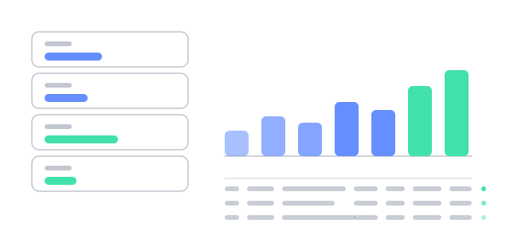

English | [中文](README.zh.md)

# dsh-usage-statistics

A community plugin for [DeepSeek Harness](https://github.com/deepseek-ai/deepseek-harness) that adds a
**用量统计 / Usage statistics** page to the left rail: per-day and per-hour token usage, the cache hit
rate, and a live request log that updates the moment a reply settles.

It is not an official DeepSeek package. It is a profile bundle: one directory, plain JavaScript, no
build step, no dependencies, no network calls.



## What the page shows

- **Range toolbar** — today, the last 7 days, the last 30 days, or any two dates of your own.
- **Three headline figures** — the range total (split into new input, cache traffic, and output), the
  request count with the average per request, and the cache hit rate.
- **A vertical histogram** — one column per day, or per hour when the range is a single day, with
  cache misses grey, cache hits green, and output orange. Hovering a column for one second shows the
  exact numbers behind it.
- **A live request log** — the newest requests in the range with time, directory, provider, model, new
  input, cache read, output, speed (tokens/second), and first-token latency. A row that arrives while
  you watch pops in with a flashing border.
- **A pinned bottom bar** — today's live figures, whatever range the rest of the page is showing.

## Install

```bash
git clone https://github.com/xq25478/dsh-usage-statistics.git ~/dsh-plugins/dsh-usage-statistics
```

Then in DeepSeek Harness open **Plugins → Add plugin** and pick that directory, or install the path
directly:

```text
plugin_manager install_bundle  target=~/dsh-plugins/dsh-usage-statistics
```

The plugin appears in the left rail as a bar-chart icon below the session list. It needs DeepSeek
Harness `0.2.2-rc.3` or newer; it reads `~/.dsh/sessions` and nothing else.

## How it updates

There is no polling. On open, the page holds one NDJSON stream to the Host
(`/api/token-usage-daily/stream`); the Host pushes a fresh snapshot whenever a reply settles,
coalescing bursts into one push per 400 ms and sending a heartbeat every 20 s. A quiet stream is
reopened after 1.5 s, a stream that has delivered nothing for 45 s is treated as dead, and returning
to the tab asks for a fresh snapshot. The log header shows the time of the last push, so a stalled
channel is visible instead of silent.

## Data sources

Every number comes from one place: the `usage` block that the model call itself reports, written by
the agent loop into the durable session log. Nothing is estimated, sampled, or inferred from message
text.

| Layer | What it provides | Where it comes from |
|---|---|---|
| Usage counts | `inputTokens` (uncached prompt), `cacheReadTokens`, `cacheWriteTokens`, `outputTokens`, and the provider's own total | The provider response, mapped by the active LLM adapter into the harness `TokenUsage` shape, whose counts are documented as disjoint |
| Event time | The instant the reply settled, in epoch milliseconds | The session event envelope (`event.time`) |
| Corpus | Which sessions exist | `ctx.sessionQuery.listSessions()` |
| Log bodies | Every committed event of one session, including fork seed metadata | `ctx.sessionQuery.readSession(id)`: the Host reads and replay-validates the JSONL, zstd frames included; this plugin never parses or decompresses a log itself |
| Live increments | New replies while the page is open | The `session/event` feed, fanned out to open streams as a snapshot push |
| Day boundary | Which day a sample belongs to | The Host process's local calendar date (`Intl` zone) |
| Range | Which days are in view | `from`/`to` local day keys, or a `days` count; the Host caps a range at 366 days and reads a reversed pair the way it was meant |

### Why the totals can be trusted

- **They are the provider's own numbers, and the arithmetic reproduces the provider's total.** In one
  real corpus, 1,755 records carried both the four counts and the provider's `totalTokens`; the
  four-count sum equals `totalTokens` in every one of them (absolute difference 0). The only aggregate
  gap was exactly the five older records that report no `totalTokens` at all.
- **Replacement, not double counting.** A streamed sample for a step is replaced by that step's
  settlement, so one request counts once; `llm/retry-started` reopens the slot so a retried attempt
  counts on its own.
- **Forks do not bill twice.** A seeded session's inherited events are skipped
  (`inheritedEventCount`), so a fork never re-adds its parent's history.
- **Cross-checked per session.** For every session, the ledger's total equals the raw sum of that
  session's `assistant/message.usage` fields.

### What is *not* guaranteed

- A reply whose provider reports no usage adds nothing, so the page can only undercount.
- Usage is attributed to the day the reply **settled**; a request that starts before midnight and
  finishes after it lands on the second day.
- Sessions written by another Host process while this one runs are not picked up until a restart; the
  page states how many sessions and usage records its scan covered.
- Cache fields exist only when the provider reports them.
- Token counts are not currency. Pricing, discounts, and cache-read surcharges live with the
  provider's billing console.

## Speed and first-token latency

- Speed is `outputTokens / (last output chunk − first output chunk)`.
- First-token latency is `first output chunk − step start`.

Both read the timestamps the stream recorder stamps on every chunk, so they share the session clock
rather than a second one. A reply with no output chunk, or a decode window shorter than 200 ms, shows
`—` instead of a meaningless rate.

## Files

| File | Role |
|---|---|
| `index.js` | Host entry: owns the ledger, the live event feed, the snapshot route, and the stream route |
| `ledger.js` | The fold itself: pure event-to-day/hour/request aggregation, no Harness imports |
| `client.js` | Browser module: the rail icon and the page |
| `cordis.patch.yml` | The one Loader row this bundle inserts |
| `locale/` | Plugin title, description, and detail document path per language |
| `docs/` | Feature image and the detail documents |
| `tests/` | Node checks: fold rules, the Host entry against a real corpus, and the page's render path |

## Tests

```bash
node tests/ledger.test.mjs   # replacement, retry, fork seed, midnight, ranges, hourly buckets
node tests/client.test.mjs   # registrations, dictionaries, theme tokens, render path
node tests/host.test.mjs     # the Host entry mounted on this machine's sessions (needs `zstd`)
```

The Host test reads the local session corpus; it prints the figures the page would show and asserts
the routes, the push stream, and the row limit.

## License

MIT. See [LICENSE](LICENSE).

---

A community plugin, not an official DeepSeek package. Built and verified with DeepSeek Harness.

[](https://github.com/deepseek-ai/deepseek-harness)
