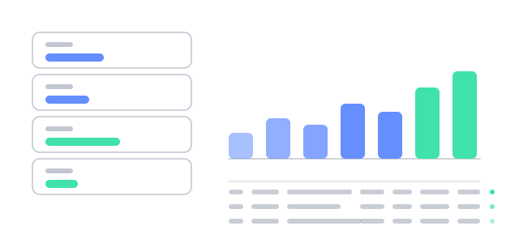

[English](README.md) | 中文

# dsh-usage-statistics（用量统计）

给 [DeepSeek Harness](https://github.com/deepseek-ai/deepseek-harness) 用的社区插件：在左侧栏新增一个
**用量统计** 页面，按天／按小时展示 token 用量、缓存命中率，以及一个随回复落地实时更新的请求日志。

这不是 DeepSeek 官方包，而是一个 profile bundle：一个目录、纯 JavaScript、无构建、无依赖、不联网。



## 页面里有什么

- **时间范围工具栏**：今天 / 近 7 天 / 近 30 天 / 自定义起止日期
- **三个主指标**：范围合计（拆成新输入、缓存、输出）、请求数与平均每次请求 token、缓存命中率
- **纵向直方图**：多日按天、单日按小时；未命中灰、命中绿、输出橙；悬停 1 秒显示该柱的具体数字
- **实时请求日志**：时间、目录、供应商、模型、新输入、缓存读取、输出、速度（tok/s）、首字延迟；
  页面打开后新到达的行会弹出并闪烁边框。token 数量统一按「万／亿」显示（`930,435,062` 显示为 `9.3亿`），悬停看精确值
- **底部常驻条**：无论上面看的是哪个范围，这里始终显示「今天」的实时数字

## 安装

```bash
git clone https://github.com/xq25478/dsh-usage-statistics.git ~/dsh-plugins/dsh-usage-statistics
```

然后在 DeepSeek Harness 里打开 **Plugins → Add plugin**，选中该目录；或直接按路径安装：

```text
plugin_manager install_bundle  target=~/dsh-plugins/dsh-usage-statistics
```

装好后左侧栏会话列表下方会出现柱状图标。需要 DeepSeek Harness `0.2.2-rc.3` 或更新版本；
插件只读取 `~/.dsh/sessions`，不写任何东西。

## 单位

所有 token 数量统一按 **万 / 亿** 显示，不区分语言：`930,435,062` 读作 `9.3亿`，`4,562,325` 读作
`456.2万`，一万以下的数字保持原值。精确数值保留在悬停提示、tooltip 和无障碍名称里。

## 更新机制

没有轮询。打开页面时前端只连一条 NDJSON 流（`/api/usage-statistics/stream`），Host 在每次回复落地时
推送一份快照：400ms 内的突发合并成一帧，空闲时每 20 秒一个心跳。流断开后 1.5 秒重连，45 秒收不到任何帧
视为死连接，切回标签页会主动重开。日志标题旁显示「实时 · HH:MM:SS 更新」，通道卡住看得见，不会静默。

## 数据来源

页面上的每个数字都只有一个来源：模型调用自己上报的 `usage`，由 agent loop 写进持久会话日志。没有任何估算、
采样，或从消息文本推断。

| 层 | 内容 | 出处 |
|---|---|---|
| 用量 | `inputTokens`（未命中缓存的输入）、`cacheReadTokens`、`cacheWriteTokens`、`outputTokens`、服务商自报的 total | 服务商响应，经 LLM 适配器映射为 harness 的 `TokenUsage`，其各项计数在契约里声明为互不重叠 |
| 时间 | 回复落地的毫秒时间戳 | 会话事件信封 `event.time` |
| 会话清单 | 有哪些会话 | `ctx.sessionQuery.listSessions()` |
| 日志正文 | 一个会话的全部已提交事件（含分叉种子标记） | `ctx.sessionQuery.readSession(id)`：Host 负责解压多帧 zstd 并回放校验，插件不自己解析日志 |
| 增量 | 页面打开期间的新回复 | `session/event` 事件流，扇出为流上的快照推送 |
| 归日 | 样本属于哪一天 | Host 进程本地日历（`Intl` 时区） |
| 范围 | 显示哪几天 | `from`/`to` 本地日键或 `days` 计数；Host 限制最多 366 天，起止反了按本意读 |

### 为什么数字可信

- **就是服务商自己的数字，而且算得平**：在一份真实语料里，1,755 条同时带四项计数和服务商 `totalTokens`
  的记录，四项之和与 `totalTokens` **逐条完全相等**（绝对差 0）；唯一的聚合差正好等于那 5 条没有上报
  `totalTokens` 的旧记录。
- **替换而非重复计数**：同一步的流式样本会被该步的结算值替换，一次请求只算一次；`llm/retry-started`
  会重开槽位，重试单独计一次。
- **分叉不重复计费**：带种子的会话跳过继承事件（`inheritedEventCount`），不会把父会话的历史再加一遍。
- **按会话独立重算**：每个会话的账本合计等于该会话 `assistant/message.usage` 的原始求和。

### 不保证的地方

- 服务商没上报 `usage` 的回复贡献为 0，所以页面只会少算。
- 用量归到回复**落地**的那一天，跨午夜的请求算到次日。
- 本进程运行期间由其它进程写入的会话，要重启后才会出现；页面会写扫了多少会话、多少条记录。
- 缓存字段只在服务商上报时存在。
- token 不等于钱：价格、折扣、缓存读的计价系数只在服务商账单里。

## 速度与首字延迟

- 速度 = `输出 token ÷ (最后一个输出 chunk 时间 − 第一个输出 chunk 时间)`
- 首字延迟 = `第一个输出 chunk 时间 − 该 step 的 step/start 时间`

两者都用流记录器给每个 chunk 打的时间戳，与事件时间同一时基。没有输出 chunk、或解码窗口短于 200ms 的
回复显示 `—`，不给无意义的速度。

## 测试

```bash
node tests/ledger.test.mjs   # 替换、重试、分叉种子、跨午夜、范围、小时桶
node tests/client.test.mjs   # 槽位注册、词典、主题 token、渲染路径
node tests/host.test.mjs     # 在本机会话库上挂 Host 入口（需要 zstd）
```

## 许可

MIT，见 [LICENSE](LICENSE)。

---

社区插件，非 DeepSeek 官方包。使用 DeepSeek Harness 构建并验证。

[](https://github.com/deepseek-ai/deepseek-harness)
